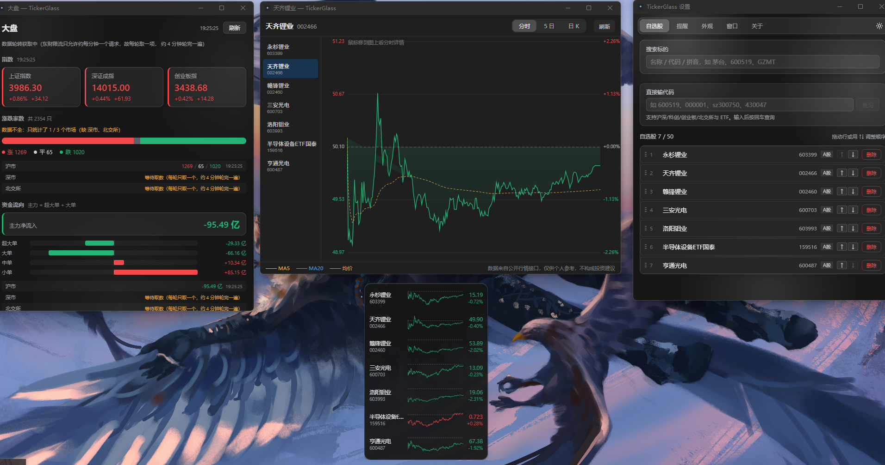

# TickerGlass

常驻桌面的透明行情悬浮窗。Windows 10/11 x64，免安装单文件。

盯盘时不必切网页、不必开券商软件 —— 一个半透明小窗贴在桌面角落，
实时价格、当日分时曲线、到价提醒都在里面。



## 快速开始

到 [Releases](../../releases) 下载 `TickerGlass.zip`，解压后双击 `TickerGlass.exe`。

免安装、不需要装任何运行库（WebView2 是 Win10/11 自带的）。

> 首次运行 Windows SmartScreen 可能提示「已保护你的电脑」——
> 点「更多信息」→「仍要运行」。这是未做代码签名的正常表现，个人项目一般不买证书。

启动后桌面上出现一个半透明小窗。**右键**它弹出菜单，或**双击**空白处，都能打开设置。

### 第一件事：加自选股

设置 → 自选股 → 搜索框。三种输入都认：

| 输入 | 例子 |
|---|---|
| 中文名称 | `永杉锂业` |
| 拼音首字母 | `ysly`（大小写不敏感） |
| 代码 | `600519` / `sz300750` / `hk00700` / `usAAPL` / `510300` |

裸数字代码会自动判断沪深归属；遇到 `000001` 这类沪深同号的，会同时列出两个候选让你选。

## 功能

**悬浮窗**

- 透明背景 + 实时价格 + 当日分时曲线，窗口高度按内容自动伸缩
- **两种形态**：星空球（单只轮播，单击展开）与列表（双击空白处收起为球），托盘/右键菜单可切换
- 分时图带 **0 轴基准线与黄色均价线**（累计成交额/成交量，按市场量纲计算），悬停可读任意时刻的价格与均价
- **悬停某一行，行末外侧浮现该股当日主力/散户净流入**（独立提示窗，主窗尺寸不变；可在设置里关闭）
- 三组**互相独立**的不透明度：背景板 / 文字 / 曲线。背景调到 0 时文字与曲线仍清晰可读
- 整体缩放 0.65~1.6、字号 8~24px、曲线宽度可调
- 超过 8 只自动分页，鼠标悬停滚轮换页（上下滑入动画，方向跟手）
- 锁定模式：不可拖动 + 鼠标穿透。**解锁的唯一入口是系统托盘右键菜单**
  （窗口本身已经点不动了，这是刻意的逃生通道设计）

**自选股**

- 名称 / 拼音首字母 / 代码搜索，上限 50 只
- 拖动排序（Pointer Events 实现），或用行尾 ↑↓ 按钮
- **隐藏 ≠ 删除**：右键某行隐藏，它照常取数、照常提醒，只是不占悬浮窗的位置

**大图窗**（双击悬浮窗某行打开）

- 三个周期：当日分时 / 5 日分时 / 日 K
- **日 K 均线可自定义**：图区左上角点 × 删线、输入周期回车加线（MA5/MA20/MA10…最多 8 条），配置持久化
- 滚轮缩放（以光标为锚点，光标下那个时间点不动）
- 放大后按住左右拖动平移，双击复位
- 十字光标读数：跟随鼠标显示该时刻的价格、涨跌幅、均价、日期

**到价提醒**

- 两种触发源：涨跌幅阈值（相对昨收）、逐股止盈价/止跌价
- 填基准价 + 涨跌幅可自动算出目标价；也有「按现价生成」一键填充
- **滞回状态机**：每次越界只提醒一次，价格回到阈值内侧 5% 后才重新布防，
  不会在阈值边缘反复响
- 冷却期可调（5~1800 秒），非交易时段不提醒
- 屏幕中央弹窗 + 6 种合成音色（清铃/木琴/钟磬/水滴/木鱼/双击），也能导入自己的音频
- 设置页有「预览弹窗效果」按钮，走的是与真实提醒**完全相同**的代码路径

**大盘面板**（右键菜单 → 大盘）

上证指数、深证成指、创业板指、科创50 四条指数（腾讯实时，含成交额）+ 沪深北涨跌家数 + 五档资金流向（东财 delay 域，分钟级延迟；打开即显示全部三市场，之后每 60 秒轮转刷新一个）。

**可靠性**

- **配置自动备份与自愈**：每次保存滚动留一份完好备份，配置文件被异常关机写坏时
  自动从备份恢复（自选股与设置不丢），损坏原文另存 `config.json.corrupt` 供排查
- 托盘菜单可**一键重启**（数据通道卡死、切代理后不用退出再手动拉起）

**外观**

- 日 / 夜双主题，设置窗右上角太阳/月亮图标一键切换
- 刷新间隔可调：行情 2~60 秒、分时 3~300 秒，改完立即生效不用重启

## 界面导览

截图里同时开了四个窗口，各自独立、可分别摆放：

| 窗口 | 怎么打开 | 内容 |
|---|---|---|
| 悬浮窗 | 启动即在 | 球态（单只轮播）/ 列表两形态；实时价格 + 分时曲线 |
| 大盘面板 | 右键 → 大盘 | 四大指数（含成交额）、涨跌家数、资金流向 |
| 大图窗 | 双击某一行 | 分时 / 5 日 / 日 K，可缩放拖动，均线可配 |
| 设置窗 | 右键 → 设置，或托盘左键 | 自选股 / 提醒 / 外观 / 窗口 / 关于 五页 |

### 常用操作速查

| 想做什么 | 怎么做 |
|---|---|
| 加自选股 | 设置 → 自选股 → 搜索 |
| 调顺序 | 设置页里按住某行上下拖，或用行尾 ↑↓ |
| 隐藏某只 | 在自选股列表或悬浮窗里右键该行 → 隐藏 |
| 看大图 | 双击悬浮窗里的某一行 |
| 看主力/散户资金 | 鼠标悬停悬浮窗里的某一行，行末浮现当日净流入 |
| 收起为球 | 悬浮窗列表态双击空白处，或右键 → 收起为球 |
| 加减日 K 均线 | 大图窗切到日 K，图区左上角点 × 删、输数字回车加 |
| 图表缩放 | 大图窗里滚轮；放大后按住拖动；双击复位 |
| 切主题 | 设置窗右上角的太阳/月亮图标 |
| 改刷新间隔 | 设置 → 外观 → **滚到最底部**「刷新间隔」 |
| 解锁悬浮窗 | 系统托盘图标右键 → 取消锁定 |
| 重启 / 退出 | 托盘右键 → 重启 / 退出（关窗口只是隐藏到托盘） |

## 数据来源

腾讯财经与东方财富的公开接口，全部免费、无需 API Key。**均为延时数据。**

| 用途 | 通道 |
|---|---|
| 批量报价 | 腾讯 `qt.gtimg.cn`（40 个一批，GBK 编码） |
| 分时曲线 | 腾讯 `web.ifzq.gtimg.cn`；美股走东财 `push2delay.eastmoney.com/trends2` |
| 代码搜索 | 东财 `searchapi` 主源 + `search-codetable` 兜底 |
| 个股资金流 | 东财 `push2delay.eastmoney.com`（`ulist.np` 一次拿全部自选股；约延时 15 分钟） |
| 大盘数据 | 东财 `push2delay.eastmoney.com`（v0.4.0 起与资金流同域，分钟级延迟；`push2` 实时域对轮询容忍度差已弃用） |

应用**不上传任何信息**，只访问硬编码白名单内的行情域名。配置全部存在本地。

两个实测得到的约束（改代码时要注意）：

- **东财是间隔型限流**，连发必败且探测会延长惩罚。大盘数据走 delay 域 + 轮转
  （首开取齐三市场，稳态每 60s 一个）；分时走腾讯域，v0.4.0 起按需调度
  （60s 新鲜度目标 + 每轮最多 3 只 + 失败冷却退避 + 当日磁盘缓存）。
- **分时是每个标的一个请求**（不是批量），所以间隔要乘以自选股数量才是真实请求速率。
  这就是为什么分时的间隔下限（3 秒）比报价（2 秒）高。

### 配置文件位置

```
%APPDATA%\StockPetPlus\config.json
```

> 目录名是早期命名的遗留。改成 `TickerGlass` 会让老用户的配置全部孤立，所以保留。

自定义提示音复制到同目录的 `sounds\` 下 —— 配置里只存文件名，
这样原文件被删或移动后提示音不会突然失效。

## 从源码构建

### 环境

- Node.js 18+
- Rust 1.77+（`rust-version` 下限）
- Windows 10/11 x64 + WebView2（系统自带）

### 命令

```bash
npm install

# 开发（热重载）
npm run dev                 # 只起 vite，配合下面的 debug 包用
node -e "require('@tauri-apps/cli').run(['dev'],'tickerglass')"

# 出包
node -e "require('@tauri-apps/cli').run(['bui
...[254 chars omitted]...
`—— 前端会去连 `localhost:1420`，没起 dev server 时
> 所有窗口都是 `ERR_CONNECTION_REFUSED`。要独立运行的包请用 release。

### 测试

```bash
npx tsc --noEmit            # 类型检查
npx vitest run              # 115 个前端单测
cd src-tauri && cargo test  # 437 个 Rust 测试（纯离线）

# 联网冒烟测试（默认跳过，验证真实接口契约）
cd src-tauri && cargo test --test live_search_smoke -- --ignored --test-threads=1
```

## 架构

```
src/                          # React 前端
├── App.tsx                   # 悬浮窗（分页、右键菜单）
├── SettingsApp.tsx           # 设置窗（五个 Tab）
├── ChartApp.tsx              # 大图窗
├── MarketApp.tsx             # 大盘面板
├── PopupApp.tsx              # 屏幕中央提醒弹窗
├── components/
│   ├── chart/                # C
...[515 chars omitted]...
── domain/                # 提醒判定状态机（纯函数）
    │   ├── state.rs              # 内存快照 + 配置快照
    │   ├── scheduler.rs          # 两条轮询链路（报价 / 分时）
    │   ├── ipc.rs                # Tauri command
    │   └── window.rs             # 窗口 I/O、越界钳制（几何部分纯函数）
    └── tests/                    # 30 个集成测试 + fixtures
```

### 两条原则

**Rust 侧分层是单向的**：`net → parse → domain → state → ipc`。
`parse` 和 `domain` 不 import `reqwest`/`tauri`，所以报文解析与提醒判定能完全离线单测 ——
437 个测试里绝大多数不碰网络。

**前端只画图、不含业务判断**。连午休断点都由后端在数据里标 `break_before`，
前端不出现任何 `1130`/`1200` 这类时间常量。哪根线该断、哪个点算越界，全在 Rust 侧决定。

### 五个窗口是五个独立入口

`vite.config.ts` 配了多页构建，每个窗口一个 HTML + 一个 React root。
它们通过 Tauri 事件（`config` / `snapshot` / `alert`）同步状态，互不直接通信。

## 已知限制

- **仅 Windows**。用了 WebView2 与 Win32 窗口特性（点击穿透、无边框透明窗口、
  系统阴影关闭），没做 macOS / Linux 适配。
- **延时数据**，不是实时 Level-1。免费公开接口的固有限制。
- **不做持仓管理**，没有成本价、盈亏、仓位这些。它只是个看盘窗口。
- **未做代码签名**，首次运行会被 SmartScreen 拦一次。
- **美股分时刷新较慢**：走东财 `trends2`，那条路径限流严格，
  所以美股分时是 30 秒一次（v0.4.0 起为固定目标，不再随分时间隔缩放）。A 股/港股不受影响。
- **大盘家数/资金流有分钟级延迟**（v0.4.0 起走 `push2delay` 镜像域换全量与稳定；
  三大指数仍走腾讯实时）。
- **个股资金流约延时 15 分钟**（走 `push2delay` 镜像域 —— 实时域对本机类
  请求限流严苛，镜像域稳定且对"当日累计主力/散户流向"的用途无感）。
  美股不提供该数据，悬停无提示。
- 分时曲线取不到数据时**不画线**，不会用昨收价画一条假直线充数。

## 反馈

发现问题欢迎开 [Issue](../../issues)。附上以下信息能大幅加快定位：

- Windows 版本、应用版本（设置 → 关于）
- 复现步骤，以及是哪个窗口出的问题
- 涉及某只股票时，带上它的代码

## 免责声明

仅供个人查看行情参考。数据可能延迟、中断或与交易所口径不一致。

## 许可

[MIT](LICENSE)

行情接口的用法参考了开源项目 [StockPet](https://github.com/YellowPancake/StockPet)（MIT）。
